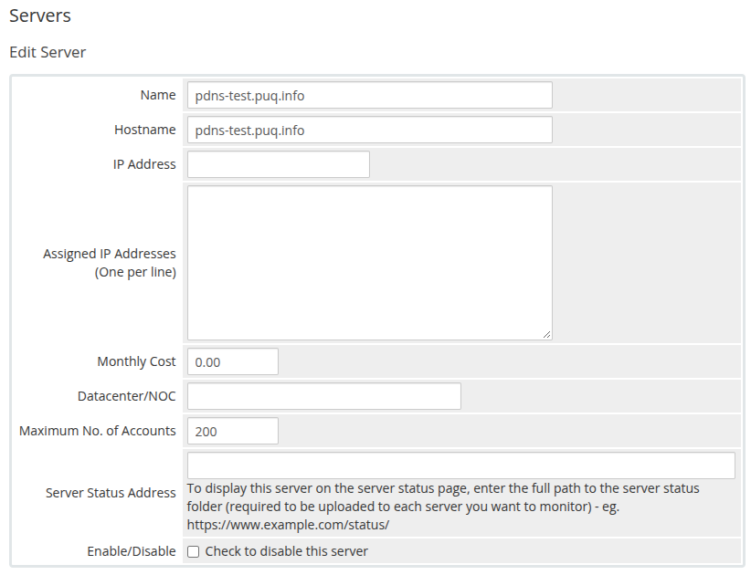
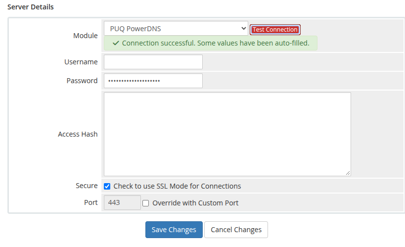

# Add Server in WHMCS

### PowerDNS module **[WHMCS](https://puqcloud.com/link.php?id=77)**
##### [Order now](https://puqcloud.com/whmcs-module-powerdns.php) | [Download](https://download.puqcloud.com/WHMCS/servers/PUQ_WHMCS-PowerDNS/) | [Community](https://community.puqcloud.com/)

Register your PowerDNS authoritative server within WHMCS so products can provision against its HTTP API.

---

## 1. Add New Server

1. In the WHMCS Admin Area, navigate to **System Settings** → **Servers** (or **Setup** → **Products/Services** → **Servers**).
2. Click **Add New Server**.
3. Fill in the primary server details:
   - **Name**: A descriptive label for the server (e.g., `PowerDNS Cluster 1`).
   - **Hostname**: The fully qualified domain name or IP address of the PowerDNS server (e.g., `pdns-test.puq.info`).
   - **IP Address**: The IP address of the PowerDNS API endpoint (optional if hostname resolves).
   - **Max No. of Accounts**: Maximum accounts assigned to this server (e.g., `200`).

*admin-server-setup.png*

---

## 2. Server Details and API Credentials

Scroll down to the **Server Details** section:

| Field | Required | Description |
|-------|----------|-------------|
| **Type** (Module) | Yes | Select **PUQ PowerDNS** from the dropdown list. |
| **Username** | No | Leave blank. PowerDNS HTTP API authentication does not use HTTP Basic usernames. |
| **Password** | Yes | Enter your PowerDNS `api-key` (from `pdns.conf`). The module transmits this via the `X-API-Key` HTTP header. |
| **Secure** | Optional | Check **Tick to use SSL Mode for Connections** if PowerDNS API is secured with HTTPS. |
| **Access Hash** | No | Leave blank. |

### Port Configuration:
- When **Secure (SSL)** is **enabled**, the module connects via HTTPS on port **`443`** by default.
- When **Secure (SSL)** is **disabled**, the module connects via HTTP on port **`8081`** by default.
- You can override the port by specifying a custom port number in the server settings or hostname (e.g. `pdns.example.com:8443`).

---

## 3. Verify Connection

1. Click the **Test Connection** button.
2. The module calls `GET /api/v1/servers/localhost` on your PowerDNS server.
3. Upon success, WHMCS displays a green notification:  
   **"Success! The test connection was successful."**
4. Click **Save Changes** to commit the server configuration.

*admin-server-details-test-connection.png*

---

## 4. Server Groups (Optional)

If you operate multiple PowerDNS nodes or clusters:
1. Navigate to **System Settings** → **Servers** → **Create New Group**.
2. Create a Server Group (e.g., `PowerDNS US Cluster`), choose your fill method (Add to least full server, or Fill active server until full), and add your PowerDNS servers.
3. Assign this server group to your products under **Module Settings**.
