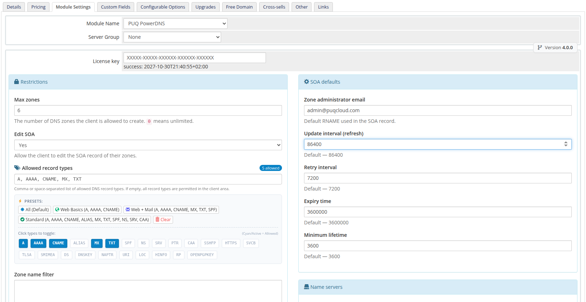
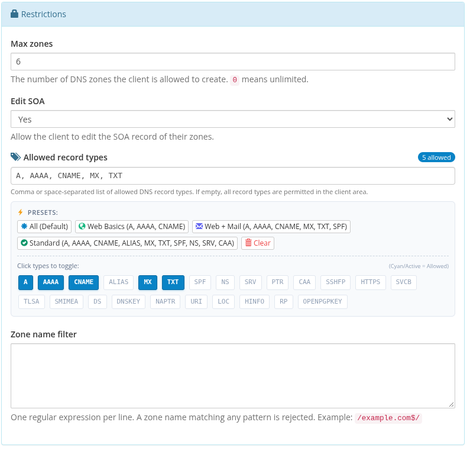
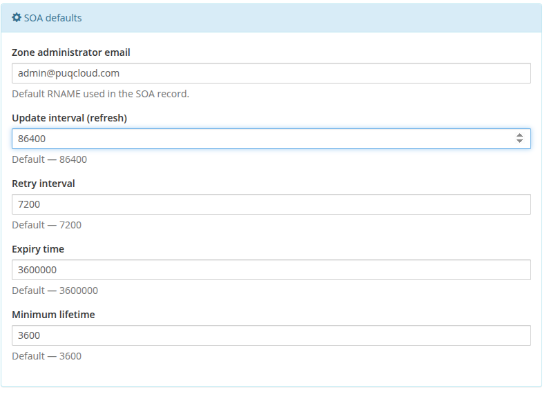
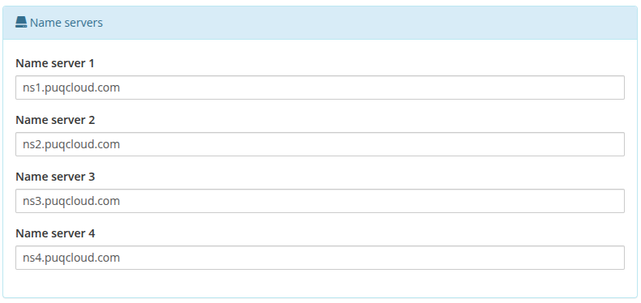
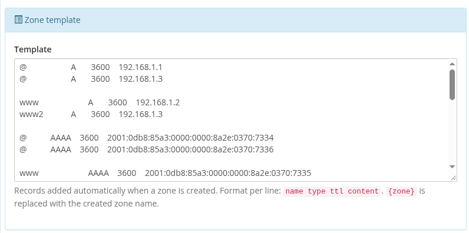

# Product Configuration

### PowerDNS module **[WHMCS](https://puqcloud.com/link.php?id=77)**
##### [Order now](https://puqcloud.com/whmcs-module-powerdns.php) | [Download](https://download.puqcloud.com/WHMCS/servers/PUQ_WHMCS-PowerDNS/) | [Community](https://community.puqcloud.com/)

Create and configure DNS hosting products using the **PUQ PowerDNS** provisioning module. All product-level policies, quotas, record filters, and templates are managed under the product's **Module Settings** tab.

---

## 1. Create Product in WHMCS

1. In the WHMCS Admin Area, navigate to **System Settings** → **Products/Services** → **Create a New Product**.
2. Select **Product Type**: `Other` (or `Shared Hosting` / `Server/VPS`).
3. Enter the **Product Name** (e.g., `DNS Hosting Premium`), assign a **Product Group**, and configure pricing.
4. Switch to the **Module Settings** tab.
5. In **Module Name**, select **PUQ PowerDNS**.
6. Under **Server Group** (or individual server), choose your PowerDNS server.
7. Enter your **License key** in the designated field.
8. The unified module configuration form loads automatically beneath the standard fields.


*admin-product-module-settings.png*

---

## 2. Restrictions Configuration

The **Restrictions** panel defines client boundaries, zone quotas, and permissible DNS record types:

| Setting | Type | Description |
|---------|------|-------------|
| **Max zones** | Integer | Maximum number of DNS zones the client can create for this service. Enter `0` for unlimited zones. |
| **Edit SOA** | Dropdown | `Yes` allows clients to edit the SOA email and TTL from the client area. `No` locks the SOA record. |
| **Allowed record types** | Text / Badges | Comma-separated list of permitted record types (e.g., `A, AAAA, CNAME, MX, TXT`). If left completely empty, **all supported record types** (plus `SOA` if Edit SOA is enabled) are permitted. |
| **Zone name filter** | Textarea | Regular expressions (one per line) matched against prospective zone names. If a submitted domain matches any regex, creation is blocked. Example: `/(^\|\.)internal\.corp$/i`. |

### Allowed Record Types & Quick Presets:
To streamline configuration, the interface provides quick preset buttons and interactive clickable badges:
- **All (Default)**: Clears the restriction filter so all supported DNS record types (`A, AAAA, AFSDB, ALIAS, CAA, CERT, CDNSKEY, CDS, CNAME, DNSKEY, DNAME, DS, HINFO, HTTPS, KEY, LOC, LUA, MX, NAPTR, NS, NSEC, NSEC3, NSEC3PARAM, OPENPGPKEY, PTR, RP, RRSIG, SMIMEA, SPF, SRV, SSHFP, SVCB, TKEY, TLSA, TSIG, TXT, URI`) are permitted.
- **Web Basics**: Quickly applies core web types (`A, AAAA, CNAME`).
- **Web + Mail**: Standard web and email types (`A, AAAA, CNAME, MX, TXT, SPF`).
- **Standard**: Expanded conventional hosting types (`A, AAAA, CNAME, ALIAS, MX, TXT, SPF, NS, SRV, CAA`).
- **Clear**: Clears the input field (which automatically enables all record types by default).
- **Interactive Badges**: Click any individual record badge to toggle it in or out of the allowed list instantly.

When restricted, the client area dynamically limits both the **Add Record** dropdown menu and client-side table filters, and enforces strict backend authorization before persisting records.


*admin-product-restrictions.png*

---

## 3. SOA Defaults

The **SOA defaults** panel defines the default parameters populated into the Start of Authority (SOA) record for every newly generated zone:

| Field | Default Value | Purpose |
|-------|---------------|---------|
| **Zone administrator email** | `admin@example.com` | RNAME field of the SOA record (dots replaced automatically). |
| **Update interval (refresh)** | `86400` (24h) | Frequency in seconds that secondary name servers query the master for changes. |
| **Retry interval** | `7200` (2h) | Frequency in seconds secondary name servers wait before retrying after a failed refresh. |
| **Expiry time** | `3600000` (~41 days) | Expiry window in seconds after which secondary servers stop answering authoritative queries if the master is unreachable. |
| **Minimum lifetime** | `3600` (1h) | Negative caching TTL for NXDOMAIN responses. |


*admin-product-soa-defaults.png*

---

## 4. Name Servers

Specify up to four authoritative name servers (**Name server 1** through **Name server 4**):
- **Name server 1** is automatically used as the primary master (MNAME) in the SOA record.
- All declared name servers are automatically generated as authoritative `NS` resource records on every zone creation.
- These name servers are presented to clients on their service dashboard to register at their domain registrars.


*admin-product-nameservers.png*

---

## 5. Zone Template

The **Zone template** allows providers to automatically populate standard DNS boilerplate records whenever a client creates a new zone.
- Enter one record per line in the format: `name type ttl content`
- Use the `{zone}` placeholder where the dynamically created zone name should be substituted.
- Use `@` for the zone apex.

### Example Template:
```text
@ A 3600 198.51.100.10
www CNAME 3600 {zone}
@ MX 3600 10 mail.{zone}
mail A 3600 198.51.100.25
@ TXT 3600 "v=spf1 mx a ~all"
```


*admin-product-zone-template.png*

---

## 6. Backward Compatibility & Automatic Migration

The module features a seamless auto-migration subsystem:
- Legacy products configured with module versions v2.x or v3.x (which utilized raw WHMCS `configoption3`, `configoption4`, `configoption5`, and `configoption7` slots) continue to function without interruption.
- Upon viewing or saving the product, the module automatically reads legacy parameters and migrates them into the unified JSON payload in `configoption24`.
