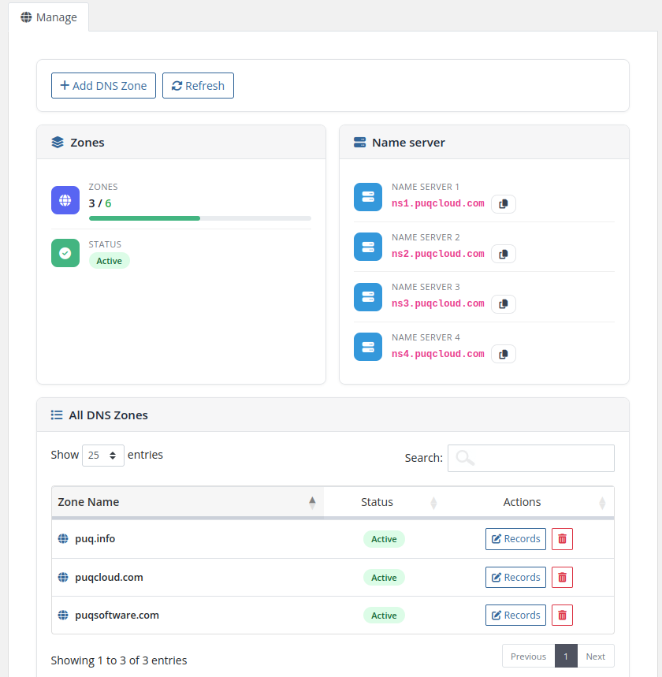

# Home screen

### PowerDNS module **[WHMCS](https://puqcloud.com/link.php?id=77)**
##### [Order now](https://puqcloud.com/whmcs-module-powerdns.php) | [Download](https://download.puqcloud.com/WHMCS/servers/PUQ_WHMCS-PowerDNS/) | [Community](https://community.puqcloud.com/)

When a client navigates to **Client Area** → **Services** → **My Services** and selects their DNS Hosting service, the dashboard presents the primary zone management interface.

*client-overview.png*

---

## 1. Summary Cards

The top overview section provides real-time status metrics and configuration parameters:

- **Zones Quota Card**: Displays current utilization against the service quota (e.g., `1 / 10` or `Unlimited`). If the allocated limit is reached, the **Add DNS Zone** action informs the client that the quota has been met.
- **Name Servers Card**: Displays the authoritative name servers (e.g., `ns1.puq.info`, `ns2.puq.info`) assigned by the hosting provider. Clients must configure these exact name servers at their domain registrar for DNS propagation.

---

## 2. DNS Zones Table

The main section lists all DNS zones provisioned under this service:

| Column | Description |
|--------|-------------|
| **Zone Name** | The root domain name of the zone (e.g., `puq.info`). |
| **Status** | Current operational state: `Active` (green badge, active on server), `Suspended` (yellow badge, server zone purged due to billing suspension), or `Not Allowed` (red badge, conflict detected). |
| **Actions** | Action controls available for each individual zone. |

### Available Zone Actions:
- **Records**: Opens the zone inspector to manage resource records. Displays an inline counter badge showing the number of active records.
- **Delete (Trash Icon)**: Removes the zone completely. Opens a SweetAlert confirmation modal before purging the zone from both PowerDNS and WHMCS. All actions feature dynamic button spinners while executing.

---

## 3. Real-Time Search & Add Zone

- **Search**: A live search field above the table allows clients to filter zones instantly as they type.
- **Add DNS Zone Button**: Located in the top action bar, opens the zone creation modal (see *Add DNS Zone*).
