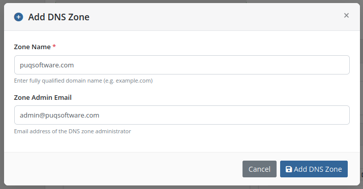

# Add DNS Zone

### PowerDNS module **[WHMCS](https://puqcloud.com/link.php?id=77)**
##### [Order now](https://puqcloud.com/whmcs-module-powerdns.php) | [Download](https://download.puqcloud.com/WHMCS/servers/PUQ_WHMCS-PowerDNS/) | [Community](https://community.puqcloud.com/)

Clients can add new forward or reverse DNS zones as long as their service has remaining quota.

---

## 1. How to Add a Zone

1. On the service overview page, click the **Add DNS Zone** button.
2. In the modal dialog:
   - **Zone Name**: Enter the domain name (e.g., `puq.info` or `113.0.203.in-addr.arpa` for reverse DNS).
   - **Zone Admin Email**: If the hosting provider enables SOA editing, clients can enter a custom administrative contact email. Otherwise, this field is hidden and provider defaults are used.
3. Click **Add DNS Zone**.

*client-add-dns-zone.png*

---

## 2. Automated Zone Provisioning Workflow

When the client clicks **Add DNS Zone**:
1. **Quota Check**: WHMCS verifies that the client has not exceeded their service's maximum zone limit.
2. **Regex Validation**: The domain name is verified for syntax compliance and checked against the provider's **Zone name filter** blacklist.
3. **PowerDNS Creation**: The module sends a `POST /api/v1/servers/localhost/zones` request to PowerDNS:
   - Zone is created as **Master** with `SOA-EDIT-API = INCREASE`.
   - The **SOA record** is built using provider defaults and the client's email (if provided).
   - **NS records** are automatically inserted for all configured name servers.
   - Any boilerplate records defined in the provider's **Zone template** are generated with the `{zone}` placeholder substituted.
4. **Local Database Synchronization**: WHMCS stores the zone record in `puqPowerDNS_zones` with status `active`.
5. The modal closes and the dashboard updates automatically with a success toast notification.

---

## 3. Validation and Error Handling

- **Maximum zone limit reached**: The service has reached its assigned zone capacity.
- **DNS Zone name is NOT valid**: The entered string does not match standard domain or in-addr.arpa syntax.
- **DNS Zone name NOT allowed**: The requested domain matches an administrative regex blacklist pattern.
- **Problem adding DNS zone**: If the zone already exists on the PowerDNS server under another service, the module avoids exposing raw database errors. It flags the request as **not allowed** and raises an automated internal To-Do task for hosting staff.
