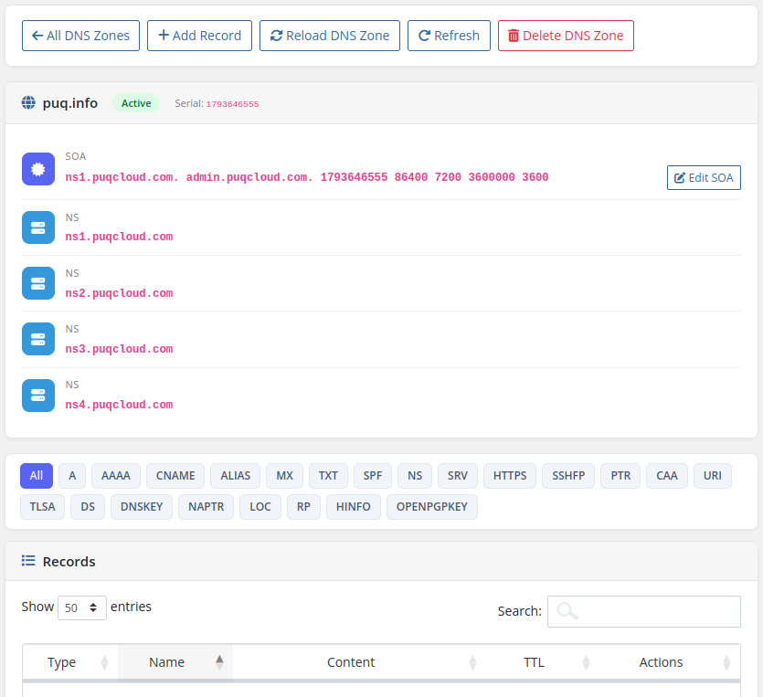
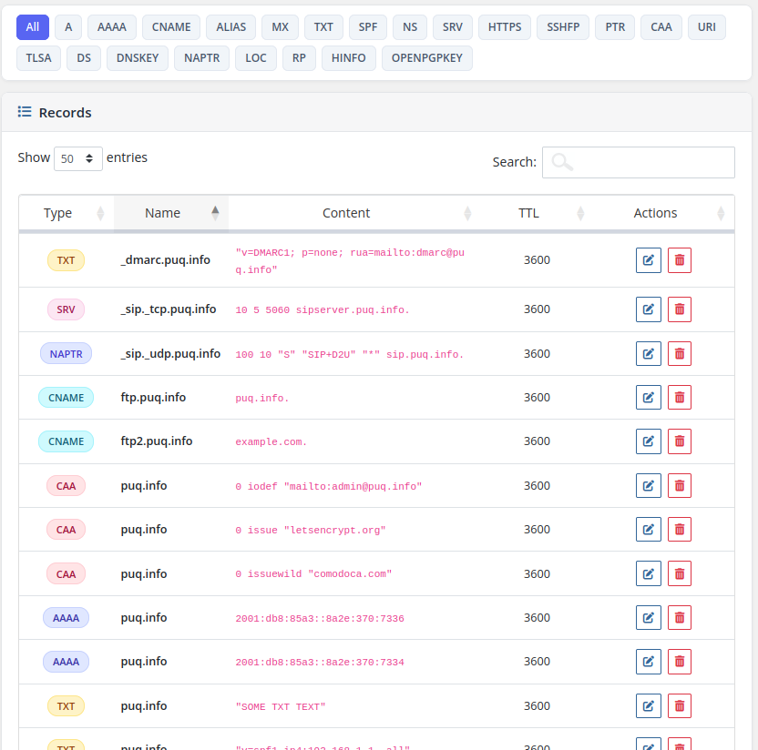
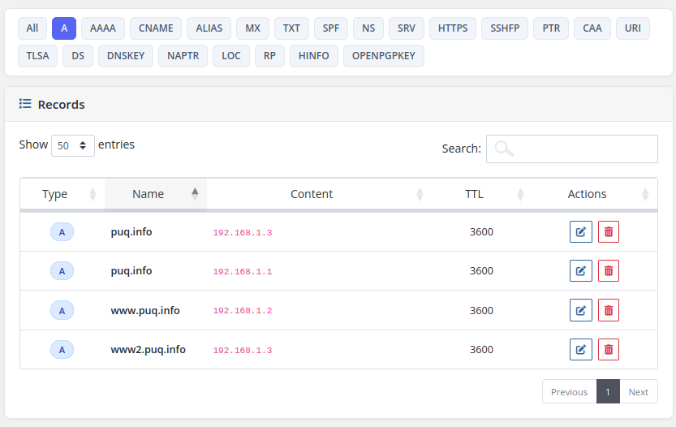
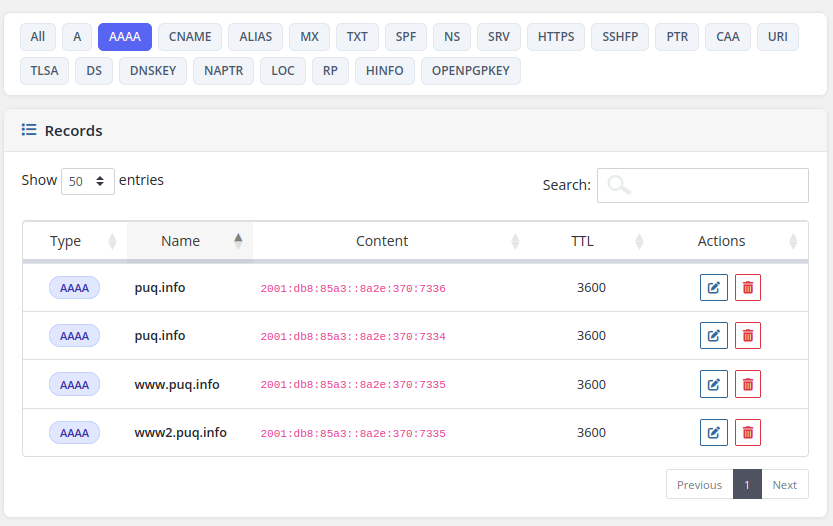
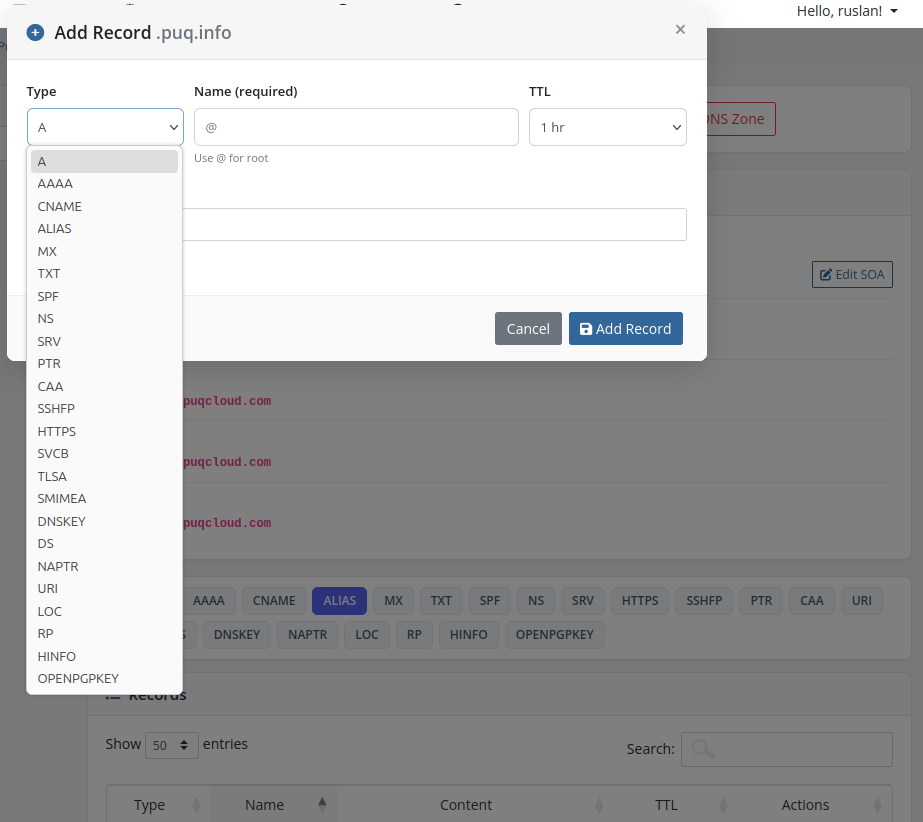
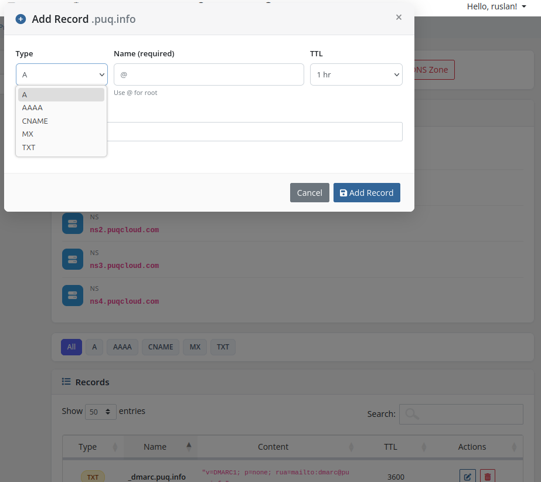
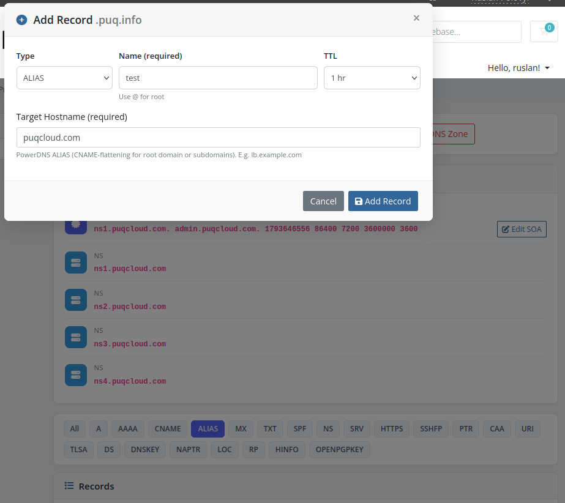
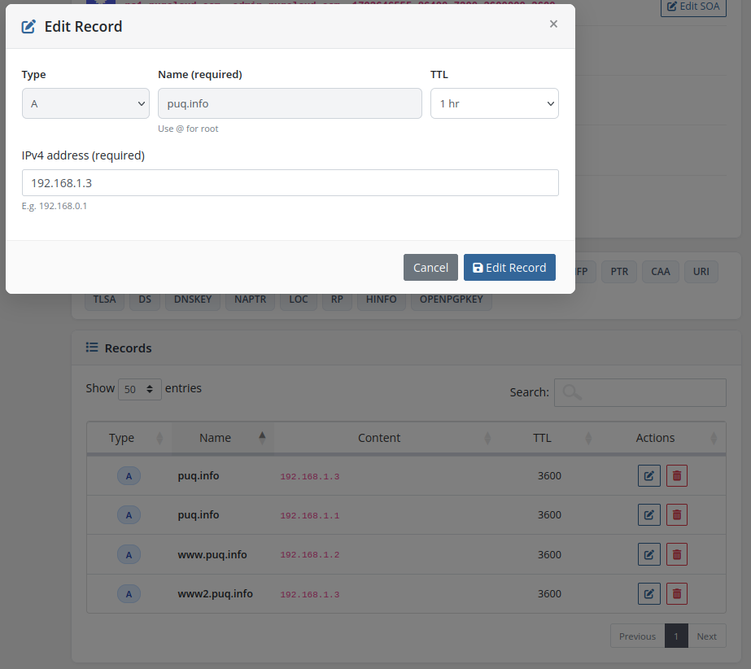

# Managing DNS Records

### PowerDNS module **[WHMCS](https://puqcloud.com/link.php?id=77)**
##### [Order now](https://puqcloud.com/whmcs-module-powerdns.php) | [Download](https://download.puqcloud.com/WHMCS/servers/PUQ_WHMCS-PowerDNS/) | [Community](https://community.puqcloud.com/)

Click the **Records** button next to any active zone to access the DNS Records management console.

---

## 1. Zone Details & Toolbar

The zone view displays zone metadata, Start of Authority (SOA) details, and quick action buttons:

- **All DNS Zones**: Returns to the main service overview.
- **Reload DNS Zone**: Synchronizes and rebuilds zone records directly from the PowerDNS server.
- **Add Record**: Opens the dynamic modal to create a new DNS record.
- **SOA Summary Card**: Displays the primary MNAME server, administrative email (RNAME), and serial number. If permitted by the provider, an **Edit SOA** button allows clients to modify contact email and TTL parameters.

*client-zone-details.png*

---

## 2. Resource Records Table & Quick Filters

Below the zone header, the console presents the resource records in a responsive table.

### Interactive Quick-Filter Pills:
Above the table, interactive badge pills allow instant filtering by record type (e.g. **All**, **A**, **AAAA**, **CNAME**, **MX**, **TXT**, etc.).
- When the hosting provider restricts allowed record types, only the permitted record type pills are displayed.
- Clicking any pill immediately filters the table view without triggering network calls or page reloads.

*client-records-table.png*

### Filtered Records View Examples:

*client-records-filter-a.png*

*client-records-filter-aaaa.png*

---

## 3. Supported Record Types

The module supports 38 DNS record types. The modal dynamically adapts input fields and validation according to the selected type:

| Type | Description & Specific Fields |
|------|------------------------------|
| **A** | Host IPv4 address (e.g. `192.0.2.1`). |
| **AAAA** | Host IPv6 address (e.g. `2001:db8::1`). |
| **AFSDB** | AFS Data Base location record (Subtype and Target hostname). |
| **ALIAS** | Auto-resolved apex or subdomain alias (CNAME-flattening) to target hostname. |
| **CAA** | Certification Authority Authorization (Flags `0`–`255`, Tag `issue`/`issuewild`/`iodef`, Value). |
| **CERT** | Certificate record (Certificate Type, Key Tag, Algorithm, Base64 Certificate). |
| **CDNSKEY** | Child DNSKEY record for automated DS updates (Flags, Protocol, Algorithm, Public Key). |
| **CDS** | Child DS record for automated parent zone DS updates (Key Tag, Algorithm, Digest Type, Digest). |
| **CNAME** | Canonical name alias pointing to target hostname. |
| **DNSKEY** | DNSSEC public key (Flags, Protocol `3`, Algorithm, Public Key). |
| **DNAME** | Delegation name redirecting an entire subtree of the domain hierarchy. |
| **DS** | Delegation Signer record (Key Tag, Algorithm, Digest Type, Digest). |
| **HINFO** | Host Information record (Hardware and OS / Software strings). |
| **HTTPS** | HTTPS service binding and parameter endpoints (Priority, Target Name, Params `key=value`). |
| **KEY** | Security public key record (Flags, Protocol, Algorithm, Public Key). |
| **LOC** | Geographic location coordinates (RFC 1876 location string). |
| **LUA** | PowerDNS dynamic LUA record (Target Type and LUA Script). |
| **MX** | Mail exchange server (Priority integer and Target mail hostname). |
| **NAPTR** | Naming Authority Pointer (Order, Preference, Flags, Service, Regexp, Replacement). |
| **NS** | Authoritative Name Server target hostname (Provider NS records are protected from deletion). |
| **NSEC** | DNSSEC Next Secure record (Next Domain Name and Record Types bitmap). |
| **NSEC3** | DNSSEC Next Secure v3 record (Hash Algorithm, Flags, Iterations, Salt, Next Hashed Owner Name, Types). |
| **NSEC3PARAM** | DNSSEC NSEC3 Parameters record (Hash Algorithm, Flags, Iterations, Salt). |
| **OPENPGPKEY** | OpenPGP public key record (Base64-encoded public key data). |
| **PTR** | Pointer record for reverse DNS mapping. |
| **RP** | Responsible Person mailbox and TXT domain pointer. |
| **RRSIG** | DNSSEC resource record signature (Type Covered, Algorithm, Labels, Original TTL, Expiration, Inception, Key Tag, Signer Name, Signature). |
| **SMIMEA** | S/MIME certificate association record (Usage, Selector, Matching Type, Certificate Association Data). |
| **SOA** | Start of Authority (Managed via provider defaults or Edit SOA modal). |
| **SPF** | Sender Policy Framework record. |
| **SRV** | Service record (Priority, Weight, Port, Target hostname). |
| **SSHFP** | SSH public host key fingerprint (Algorithm, Fingerprint Type, Hexadecimal Fingerprint). |
| **SVCB** | General Service Binding record (Priority, Target Name, Params `key=value`). |
| **TKEY** | Transaction Key record (RFC 3597 generic RDATA / hex payload). |
| **TLSA** | Transport Layer Security Authentication (Usage, Selector, Matching Type, Certificate Association Data). |
| **TSIG** | Transaction Signature record. |
| **TXT** | Text record (String content; automatically quoted and split into 255-byte chunks). |
| **URI** | Uniform Resource Identifier mapping (Priority, Weight, Target URI). |

---

## 4. Add DNS Record

1. Click the **Add Record** button.
2. Select the **Type** from the dropdown menu.
   - If the hosting provider has configured **Allowed record types**, only those specific record types appear in the dropdown.
   - If no restriction is configured, all 38 record types are available.
3. Enter the record **Name** (use `@` for root domain apex, or enter subdomains like `www`, `api`, `mail`).
4. Select the **TTL** (from 60 seconds up to 1 day).
5. Enter the type-specific data values.
6. Click **Add Record**. A loading spinner indicates active processing. Upon success, the table updates immediately.

### Full Record Types Dropdown:

*client-add-record-all-types.png*

### Restricted Allowed Record Types Dropdown:
When the administrator restricts allowed record types to e.g. `A, AAAA, CNAME, MX, TXT`:

*client-add-record-filtered-types.png*

### ALIAS Record Addition:

*client-add-record-alias.png*

---

## 5. Edit and Delete Records

### Edit Record:
Click the **Pencil icon** on any record row. The edit modal appears pre-populated with current values:
- Record Type and Name are locked to prevent accidental DNS orphan references.
- TTL and record content values can be adjusted and saved instantly.

*client-edit-record.png*

### Delete Record:
Click the **Trash icon** on any record row. A confirmation dialog prevents accidental deletion. Once confirmed, the record is removed from the PowerDNS server and table immediately.

> ℹ️ **Notice:** Provider root NS records (at the zone apex) are protected with a lock icon and cannot be edited or deleted by clients. Subdomain NS records (e.g. `sub.example.com`) can be added, modified, and deleted freely.
