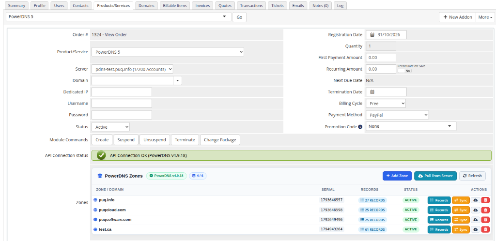
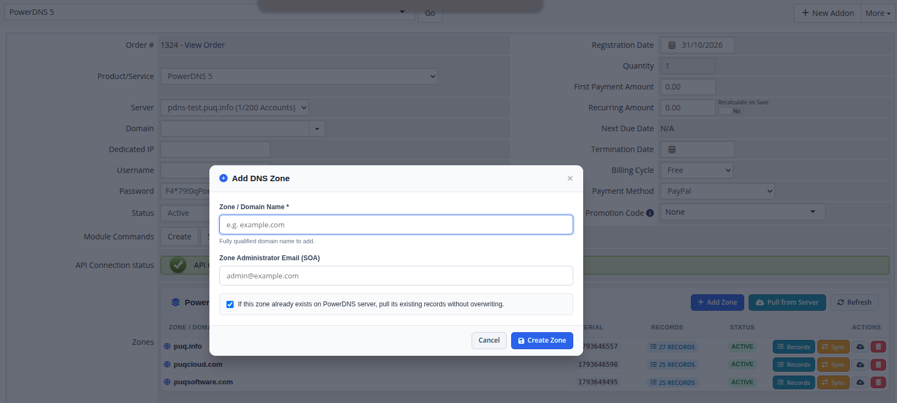
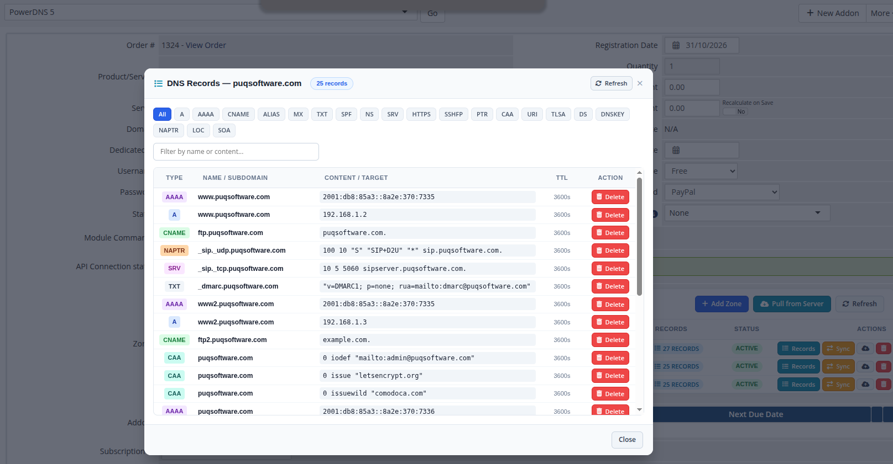
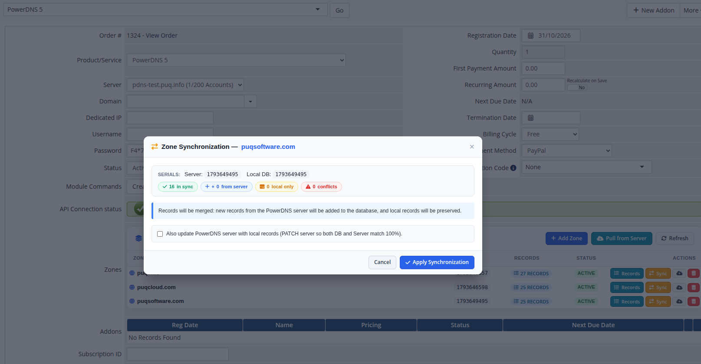

# Service Management (Admin)

### PowerDNS module **[WHMCS](https://puqcloud.com/link.php?id=77)**
##### [Order now](https://puqcloud.com/whmcs-module-powerdns.php) | [Download](https://download.puqcloud.com/WHMCS/servers/PUQ_WHMCS-PowerDNS/) | [Community](https://community.puqcloud.com/)

Administrators can manage DNS services directly from **WHMCS Admin** → **Clients** → **[Select Client]** → **Products/Services** (or via **Clients** → **Services**).

The module embeds an interactive **Zones** management section within the service details page:

*admin-service-zones.png*

---

## 1. Zones Management Table

The administrative panel displays all zones assigned to this service instance:

| Column | Description |
|--------|-------------|
| **Zone / Domain** | The fully qualified zone name. |
| **Serial** | The SOA serial number of the zone as reported by PowerDNS. |
| **Records** | Quick counter badge showing the total number of records in the zone (clickable to open the Records inspector modal). |
| **Status** | `active` (live on server), `suspended` (kept in WHMCS, purged from server), or `not allowed` (conflict detected). |
| **Actions** | Direct administrative controls for individual zones. |

### Top Toolbar & Zone Actions:
- **Add Zone**: Create a new zone directly on the service (with an option to pull existing server records if the zone already exists on PowerDNS).
- **Pull from Server**: Discover all zones hosted on the PowerDNS server and import an existing zone into this customer's service with all records preserved.
- **Refresh**: Reloads the administrative zones table via AJAX.
- **Records**: Opens the administrative **DNS Records** modal to inspect, filter by record type, search, or delete resource records directly without logging into the client area.
- **Sync**: Opens the **Zone Synchronization** modal, comparing the PowerDNS server zone with the WHMCS local database (identifying in-sync records, server-only records, local-only records, and conflicts) and allowing granular conflict resolution.
- **Push to Server (☁↑)**: Pushes the local WHMCS database records for the zone directly to the PowerDNS server.
- **Delete (🗑)**: Removes the zone from WHMCS, with a checkbox to also delete the zone from the PowerDNS server.

---

## 2. Administrative Modal Controls

### Add DNS Zone (Admin):
Administrators can provision a new zone on behalf of the customer, bypassing quota or blacklist limits when necessary:

*admin-service-add-zone.png*

### Manage DNS Records (Admin):
Inspect all active resource records, TTLs, and content strings in real time:

*admin-service-records-modal.png*

### Zone Synchronization:
The **Zone Synchronization** modal allows administrators to scan the connected PowerDNS authoritative server and import pre-existing or orphaned zones directly into the client's service:

*admin-service-sync-modal.png*

---

## 3. WHMCS Module Lifecycle Commands

The module integrates seamlessly with the standard WHMCS service lifecycle buttons:

- **Create**: Executed upon order activation. If a domain name was supplied during checkout, it is automatically provisioned as the client's first DNS zone.
- **Suspend**: Triggered upon overdue invoice or manual administrative suspension. Purges all active zones of this service from the PowerDNS authoritative server while **preserving all records in the WHMCS database** (marked as `suspended`).
- **Unsuspend**: Re-provisions all suspended zones and their corresponding records back onto the PowerDNS server.
- **Terminate**: Executed upon service cancellation or termination. Permanently deletes all associated zones and records from both the PowerDNS server and WHMCS.
