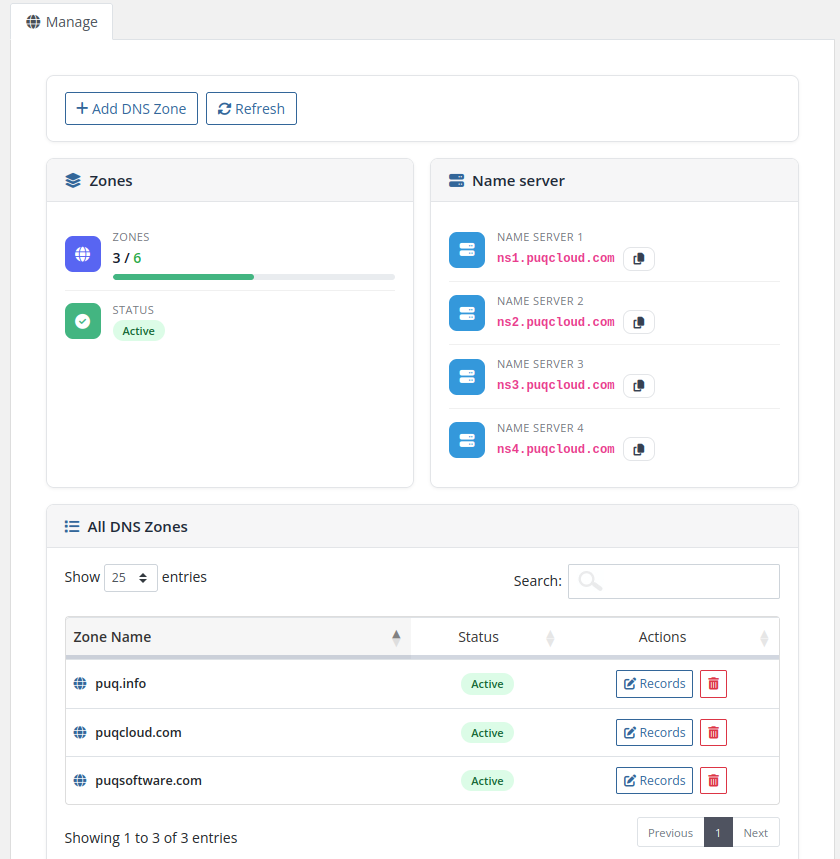
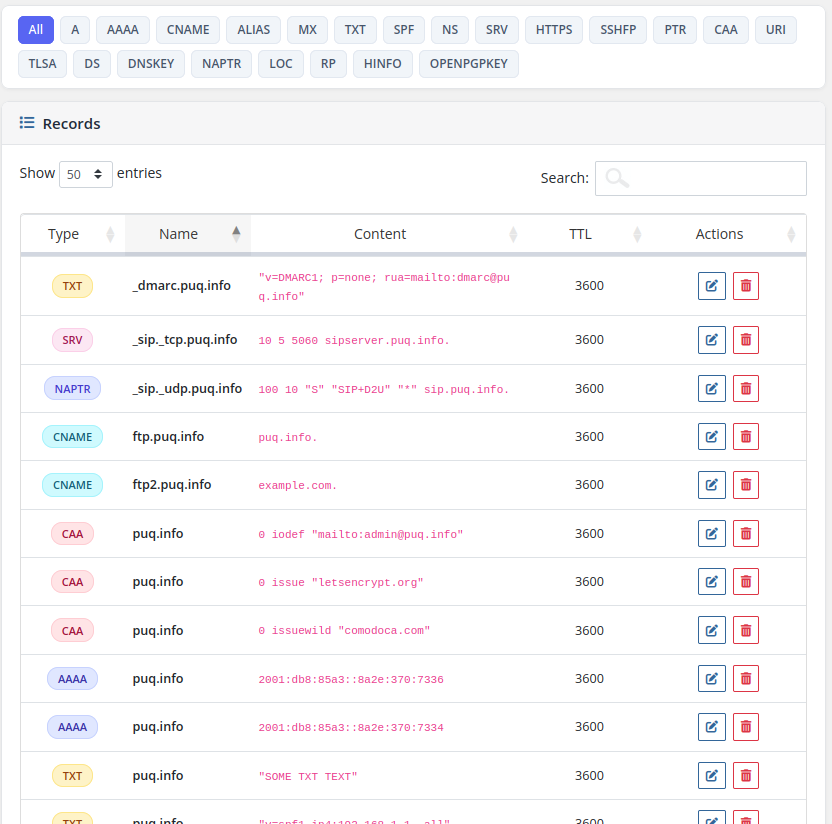
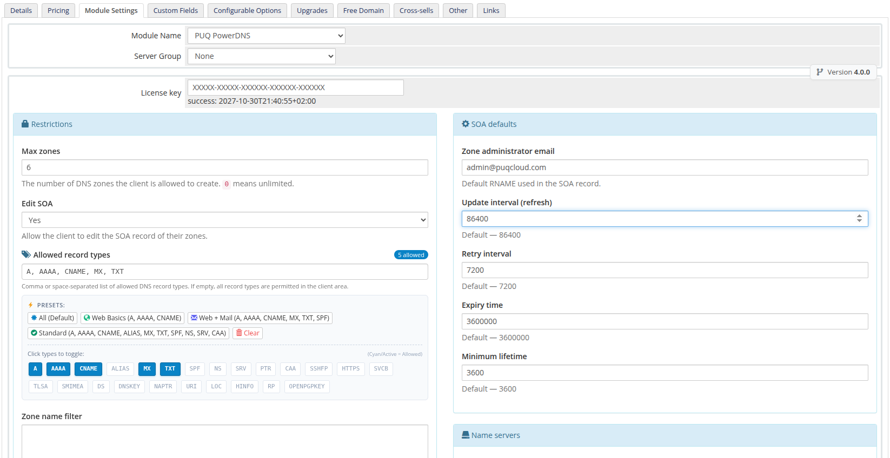
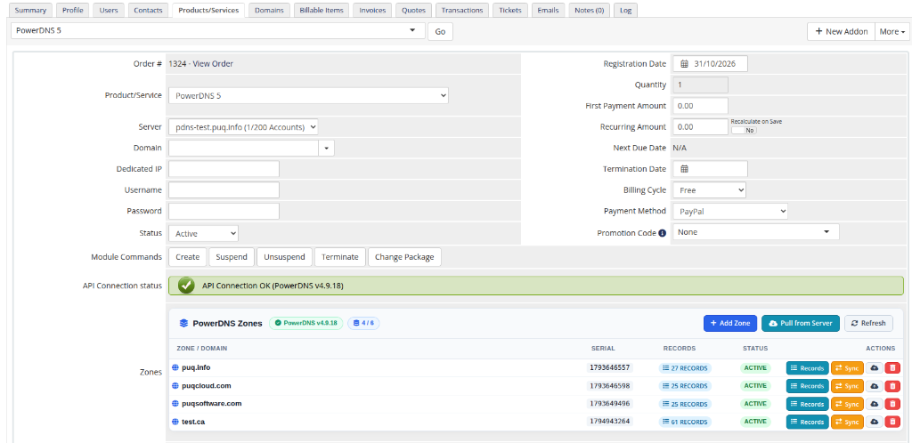

# Description

### PowerDNS module **[WHMCS](https://puqcloud.com/link.php?id=77)**
##### [Order now](https://puqcloud.com/whmcs-module-powerdns.php) | [Download](https://download.puqcloud.com/WHMCS/servers/PUQ_WHMCS-PowerDNS/) | [Community](https://community.puqcloud.com/)

## PowerDNS WHMCS module

The **PowerDNS WHMCS module** transforms your WHMCS installation into a complete, self-service DNS hosting platform. Sell DNS zone management as an independent product or package: each client service grants a configurable quota of DNS zones, allowing clients to create, edit, and delete their DNS zones and records directly from the WHMCS client area. All record updates, additions, and deletions are synchronized in real time with your authoritative **PowerDNS** server via its high-performance HTTP API.

Administrators maintain complete control over provisioning policies: set maximum zone limits per product package, enforce provider-wide SOA record defaults, assign authoritative name servers, define regex-based blacklists for forbidden domain names, configure auto-provisioned zone templates, and restrict the specific DNS record types clients are permitted to create or edit. The module natively adheres to the WHMCS service lifecycle — suspending a service removes zones from the active DNS server while preserving records in WHMCS, and terminating a service safely cleans up all zone data.

---

## Main features

- **DNS zones as a commercial product** — Sell DNS hosting packages backed by a PowerDNS authoritative server.
- **Flexible zone quota** — Configure maximum zone limits per product package (`0` for unlimited).
- **Comprehensive DNS record support** — Supports 38 standard and modern DNS record types: `A`, `AAAA`, `AFSDB`, `ALIAS`, `CAA`, `CERT`, `CDNSKEY`, `CDS`, `CNAME`, `DNSKEY`, `DNAME`, `DS`, `HINFO`, `HTTPS`, `KEY`, `LOC`, `LUA`, `MX`, `NAPTR`, `NS`, `NSEC`, `NSEC3`, `NSEC3PARAM`, `OPENPGPKEY`, `PTR`, `RP`, `RRSIG`, `SMIMEA`, `SOA`, `SPF`, `SRV`, `SSHFP`, `SVCB`, `TKEY`, `TLSA`, `TSIG`, `TXT`, and `URI`.
- **Allowed record types restrictions** — Restrict which record types clients can add or modify, with one-click presets (**All**, **Web Basics**, **Web + Mail**, **Standard**, **Clear**) and interactive badges.
- **Modern PUQ UI Toolkit client area** — Clean, card-based interface with live quick-filters, inline validation, and dynamic action button spinners (no full-page blocking preloaders).
- **Granular SOA controls** — Configure provider SOA defaults (Refresh, Retry, Expire, Minimum TTL, Administrator Email) and toggle client permission to edit SOA parameters.
- **Authoritative name servers** — Attach up to 4 authoritative name servers to every provisioned zone.
- **Zone name blacklist** — Enforce regular expressions to prevent clients from registering system, infrastructure, or forbidden apex domains.
- **Automated zone templates** — Automatically generate boilerplate DNS records upon zone creation using the `{zone}` placeholder.
- **Reverse DNS (PTR) support** — Effortlessly manage IPv4 (`in-addr.arpa`) and IPv6 (`ip6.arpa`) reverse DNS zones and PTR records.
- **Full WHMCS lifecycle synchronization** — Automated provisioning on order acceptance, suspension (server purge with WHMCS record retention), unsuspension (server reprovisioning), and termination (safe complete cleanup).
- **Administrative management suite** — Real-time zone inspector, server-to-WHMCS zone synchronization, record browser, and manual zone reload/delete directly from the WHMCS service page.
- **Conflict prevention & task automation** — Duplicate zone conflicts raise automated WHMCS staff To-Do entries without throwing unhandled exceptions to clients.
- **Full internationalization** — 26 language packages with strict typographical safety and dynamic frontend injection.
- **Enterprise license engine** — High-availability verification against PUQ licensing servers with offline caching for maximum operational resilience.

---

## System requirements

| Requirement | Minimum |
|-------------|---------|
| **WHMCS** | 8.x+, 9.x+ |
| **PHP** | 7.4, 8.1, 8.2, 8.3, 8.4 |
| **ionCube Loader** | v15+ |
| **PowerDNS Authoritative** | 4.x+ with HTTP API enabled |

---

## Links

- **Product page:** [https://puqcloud.com/whmcs-module-powerdns.php](https://puqcloud.com/whmcs-module-powerdns.php)
- **Documentation:** [https://doc.puq.info/books/powerdns-whmcs-module](https://doc.puq.info/books/powerdns-whmcs-module)
- **Support:** [https://puqcloud.com/submitticket.php?step=2&deptid=1](https://puqcloud.com/submitticket.php?step=2&deptid=1)
- **Community:** [https://community.puqcloud.com/](https://community.puqcloud.com/)

---

## Screenshots

### Client Area — DNS Zones Dashboard

*client-overview.png*

### Client Area — DNS Records Management

*client-records-table.png*

### Admin Area — Product Module Settings

*admin-product-module-settings.png*

### Admin Area — Service Zones Management

*admin-service-zones.png*
